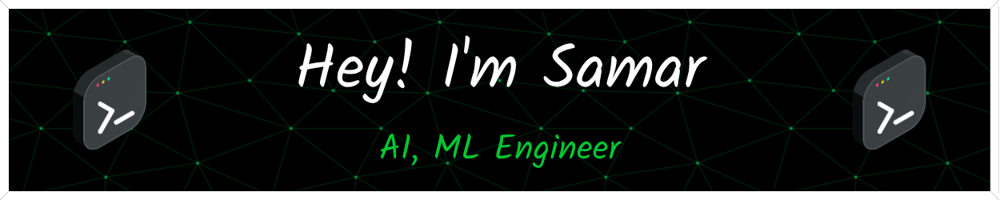
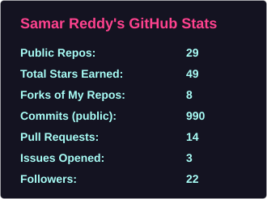
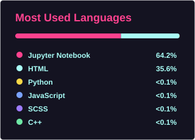

<!--
-->

<!--## Hi  I'm Samar-->
<!--
**Samarasimhareddy369/Samarasimhareddy369** is a ✨ _special_ ✨ repository because its `README.md` (this file) appears on your GitHub profile.
 -->
### About Me:
- 🔭 Mastering Artificial Intelligence, more on Deep Learning, GenAI, NLP
- 🎓 I completed my M.Tech in AI-ML (WILP, 2023-25) at BITS Pilani while working full-time, and I'm a B.Tech graduate in ECE from <a href="https://rguktrkv.ac.in/">IIIT RKValley</a>, RGUKT, AP, India
- 🚀 I started <a href="https://resnur.com">Resnur AI</a> (resnur.com), a learning and building platform for AI enthusiasts. Its <a href="https://www.linkedin.com/company/resnur-ai">LinkedIn page</a> grew to 12k+ followers in just 3 months.
- 📝 I'm a content writer, Passionate learner and a Community Influencer.
- 📊 I'm good at Management, Marketing, Problem Solving, Python, Presentations.
- 😄 Pronouns: He/Him, Researcher, Innovative:D, Tech Geek, Electronic Brian
- See <a href="https://samarasimhapeyala.github.io/">My Portfolio</a>, Star ⭐ my repositories

### Tools and Languages:

 
 <!---->
 
 

 
 
 

 

⚙️ GitHub Analytics

    

### 📫 Reach me:

### Thank you :)
